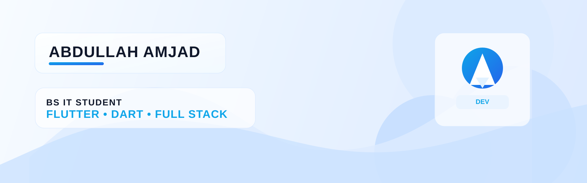

  

<h1 align="center">Hi 👋, I'm a Flutter &amp; Full-Stack Developer 💻</h1>

  A passionate <b>Flutter Mobile Developer</b> &amp; <b>Full-Stack Web Engineer</b> dedicated to building smooth cross-platform mobile apps for Android &amp; iOS, along with robust, scalable web architectures. Focused on clean code, responsive UI/UX, and high-performance applications.

<!-- Social Connect Badges -->

  
  
  
  
  

<!-- Visitor Counter (Transparent & Modern) -->

  

 
<!-- GitHub Trophies (Transparent background - adapts to both Light & Dark GitHub mode) -->

  

